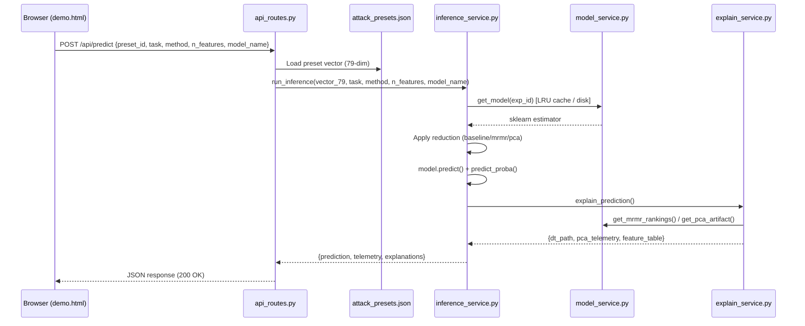

# System Architecture

## 1. High-Level System Architecture

The system consists of two major subsystems:
1. **Offline Training Pipeline** (Jupyter Notebook based) — executed once to produce all model artifacts
2. **Online Inference and Visualization Web Application** (Flask-based) — serves trained artifacts

```
┌──────────────────────────────────────────────────────────────────────────────────┐
│                     OFFLINE TRAINING PIPELINE (Jupyter Notebook)                 │
│                                                                                  │
│  IoTID20 CSV → Preprocessing → 70/30 Split → Feature Reduction → ML Training    │
│  (625,783 × 86)    (MinMax)      (438k/187k)   (Baseline/PCA/MRMR)  (6 algos)  │
│                                                                                  │
│  Outputs: 108 .joblib models, PCA/MRMR checkpoints, EDA charts, CM images       │
└──────────────────────────────────────────────────────────────────────────────────┘
                                    ▼ (artifacts persisted to disk)
┌──────────────────────────────────────────────────────────────────────────────────┐
│                     ONLINE FLASK WEB APPLICATION                                 │
│                                                                                  │
│  Browser ←→ Flask Routes ←→ Services Layer ←→ Saved Artifacts (output/)          │
│              (main_bp, api_bp)  (model_service, benchmark_service,               │
│                                  inference_service, explain_service)             │
└──────────────────────────────────────────────────────────────────────────────────┘
```

---

## 2. Flask Application Architecture (Verified)

### Component Diagram

```
app.py (Flask Factory)
├── config.py (Path constants + server config)
├── routes/
│   ├── main_routes.py (Blueprint: main_bp)
│   │   ├── GET /           → index.html (Dashboard)
│   │   ├── GET /demo       → demo.html (Live Inference UI)
│   │   ├── GET /benchmarks → benchmarks.html (108 model results table)
│   │   ├── GET /features   → features.html (PCA/MRMR analysis)
│   │   ├── GET /methodology → methodology.html (Pipeline docs)
│   │   └── Static asset routes (/assets/cm/, /assets/results/, etc.)
│   └── api_routes.py (Blueprint: api_bp, url_prefix=/api)
│       ├── GET  /api/presets   → returns preset metadata
│       ├── POST /api/predict   → live inference + explainability
│       └── GET  /api/metrics   → filtered benchmark results
├── services/
│   ├── model_service.py   (ModelService singleton — LRU model cache)
│   ├── benchmark_service.py (BenchmarkService — results_cache.json reader)
│   ├── inference_service.py (InferenceService — full inference pipeline)
│   ├── explain_service.py   (ExplainService — DT path, PCA loadings, feature table)
│   └── feature_catalog.py   (79-feature metadata catalog)
├── templates/
│   ├── base.html  (shared navbar + footer)
│   ├── index.html, demo.html, benchmarks.html, features.html, methodology.html
└── static/
    ├── css/main.css
    └── js/demo.js
```

---

## 3. Data Flow Diagram

### 3.1 Training Pipeline Data Flow (Offline, from Jupyter Notebook)

```
IoTID20 CSV (625,783 × 86)
    ↓ Drop non-feature columns (4 metadata + 2 labels = 79 features)
    ↓ Replace infinite values in Flow_Byts/s, Flow_Pkts/s
    ↓ Apply MinMax scaling [0, 1] to all 79 features
    ↓ Encode Label → binary (0/1) and Cat → 5-class (0-4) via LabelEncoder
    ↓ Stratified 70/30 split (random_state=42) → 438,048 train / 187,735 test
    ↓ Save: preprocessed_data.npz, preprocessed_meta.pkl
    ├── MRMR Track:
    │   ↓ Compute MRMR rankings separately for binary and multiclass labels
    │   ↓ Save: mrmr_binary_rankings.csv, mrmr_multiclass_rankings.csv
    └── PCA Track:
        ↓ Fit PCA on training data (all 79 features)
        ↓ Record explained variance per component
        ↓ Save: pca_result.pkl, pca_explained_variance.csv, pca_cumulative_variance.png

For each of 108 experiment configurations:
    ↓ Load preprocessed training data
    ↓ Apply feature reduction (baseline: X as-is; MRMR: select top-k; PCA: transform → k components)
    ↓ Train ML classifier
    ↓ Evaluate on 187,735 test samples → compute accuracy, precision, recall, F1, FAR, AUC, throughput, train time, model size
    ↓ Save confusion matrix PNG, ROC curve
    ↓ Save model .joblib
    ↓ Append result to results_cache.json
```

### 3.2 Live Inference Data Flow (Online, via /api/predict)

```
Browser (demo.html)
    ↓ POST /api/predict JSON body: {preset_id, task, method, n_features, model_name}
api_routes.py::predict()
    ↓ Load preset from attack_presets.json (79-dimensional normalized vector)
    ↓ Validate parameters (task, method, n_features)
inference_service.py::run_inference()
    ↓ model_service.get_model(exp_id) → load from LRU cache or disk
    ↓ Apply feature reduction to 79-dim input vector:
    │   baseline: use all 79 features
    │   mrmr:     index by MRMR ranking → k-dim slice
    │   pca:      full_pca.transform(vector_79)[:, :k] → k principal components
    ↓ model.predict(X_sub) → predicted class index
    ↓ model.predict_proba(X_sub) → class probability distribution (if supported)
    ↓ Measure inference latency (time.perf_counter)
explain_service.py::explain_prediction()
    ↓ For Decision Tree: model.decision_path() → step-by-step split conditions
    ↓ For Neural Network: architectural disclaimer (no local attribution)
    ↓ For PCA method: extract component coordinate values + top 3 original loadings
    ↓ Build feature table with raw values, normalized values, importance labels
    ↓ Return comprehensive JSON response to browser
Browser renders: threat banner, ground-truth match badge, probability bars, DT path steps / PCA table, feature table
```

---

## 4. Request–Response Workflow (API Endpoints)

### 4.1 POST /api/predict

| Field | Value |
|---|---|
| Method | POST |
| Content-Type | application/json |
| Authentication | None |
| Request body keys | `preset_id`, `task`, `method`, `n_features`, `model_name` |
| Response keys | `status`, `telemetry`, `configuration`, `prediction`, `reduction_summary`, `decision_tree_explanation`, `neural_network_explanation`, `pca_telemetry`, `feature_table`, `ground_truth` |

### 4.2 GET /api/presets

Returns summary list of all attack presets with metadata (id, name, expected labels, badge color, description, raw_features dict, normalized_features dict).

### 4.3 GET /api/metrics

Query params: `task`, `method`, `model_name`, `n_features` — returns filtered benchmark results from results_cache.json.

---

## 5. Mermaid Diagrams

### 5.1 High-Level Architecture

```mermaid
graph TB
    subgraph "Offline Pipeline (Jupyter)"
        A[IoTID20 CSV<br>625,783×86] --> B[Preprocessing<br>MinMax Scaling]
        B --> C[70/30 Stratified Split]
        C --> D1[PCA Track<br>k∈{4,12,23,50}]
        C --> D2[MRMR Track<br>k∈{4,12,23,50}]
        C --> D3[Baseline Track<br>k=79]
        D1 --> E[Train 6 Classifiers × 18 configs<br>= 108 Models]
        D2 --> E
        D3 --> E
        E --> F[output/models/<br>108 .joblib files]
        E --> G[output/results/<br>confusion_matrices, predictions]
    end

    subgraph "Online Flask Web App"
        H[Browser] -->|HTTP| I[Flask Routes<br>main_bp + api_bp]
        I --> J[Services Layer]
        J --> K[model_service<br>LRU Cache]
        J --> L[benchmark_service<br>results_cache.json]
        J --> M[inference_service<br>+ explain_service]
        K --> F
    end
```

### 5.2 Inference Data Flow



---

## 6. File Structure Summary

```
d:\Mini_Project\
├── app.py                         Flask application factory
├── config.py                      Path constants and server config
├── routes/
│   ├── main_routes.py             Page routes (Blueprint: main)
│   └── api_routes.py              API routes (Blueprint: api, /api prefix)
├── services/
│   ├── model_service.py           Model loading + LRU cache singleton
│   ├── benchmark_service.py       Results cache reader singleton
│   ├── inference_service.py       End-to-end inference orchestrator
│   ├── explain_service.py         Decision path + PCA + feature table
│   └── feature_catalog.py         79-feature metadata (names, units, meaning)
├── templates/
│   ├── base.html                  Shared layout (navbar + footer)
│   ├── index.html                 Dashboard (KPI cards)
│   ├── demo.html                  Live inference UI
│   ├── benchmarks.html            108 model results table
│   ├── features.html              PCA/MRMR analysis page
│   └── methodology.html           MATLAB-sklearn equivalence table
├── static/
│   ├── css/main.css               Complete CSS styling
│   └── js/demo.js                 Live demo interaction JavaScript
├── data_presets/
│   └── attack_presets.json        Pre-selected authentic test-set network flows
├── Data/
│   └── IoT Network Intrusion Dataset.csv   Original dataset (~295 MB)
├── basepaper/
│   └── Enhancing_Security_...pdf           Reference paper (Houkan et al. 2024)
├── output/
│   ├── checkpoints/               preprocessed_data.npz, meta.pkl, pca.pkl, results_cache.json, progress.json
│   ├── models/                    108 trained .joblib model files
│   ├── results/
│   │   ├── confusion_matrices/    110 PNG files (108 CMs + 2 CSV CMs)
│   │   ├── predictions/           108 CSV prediction files
│   │   ├── accuracy_vs_features_binary.png
│   │   └── efficiency_frontier_binary.png
│   ├── eda/                       class_distribution_*.png/csv, correlation_heatmap.png, dataset_info.txt
│   └── feature_engineering/       mrmr_*.csv, pca_cumulative_variance.png, pca_explained_variance.csv
└── IoT_Intrusion_Detection_Reproduction.ipynb   Offline training notebook
```
